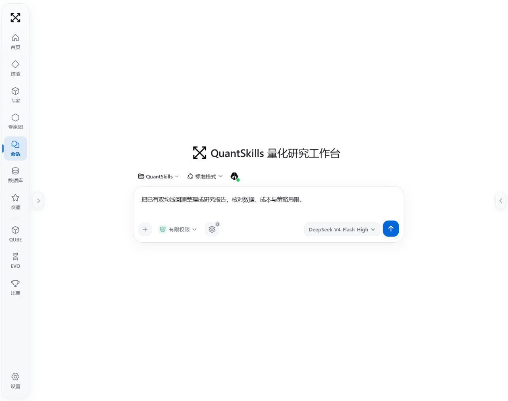
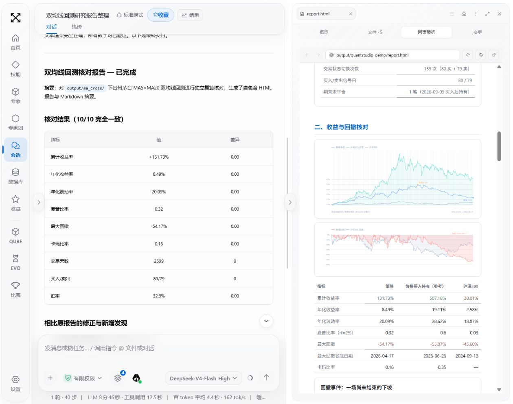
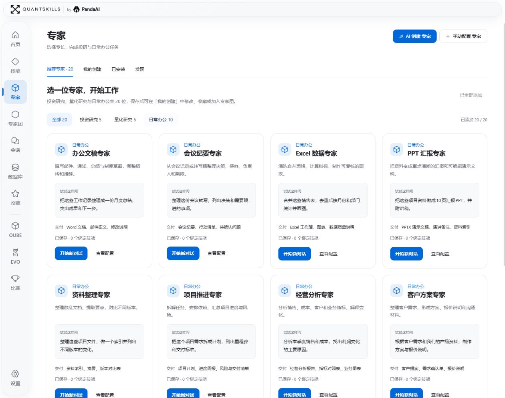

# QuantStudio

[简体中文](README.md)

QuantStudio is an open-source AI workspace that runs locally for quantitative research, data analysis, and everyday work. Review backtests, clean up spreadsheets, generate reports, and inspect or download charts, code, and files from the workspace.

The futures simulation module uses a competition CLI to connect a simulation account and review market data, trading plans, and execution receipts.



## Get started

Install **Git** and **Node.js 22.x starting at 22.19, or Node.js 24+**. The project uses pnpm 11.7.0.

Install the stable **v0.1.36** release.

```sh
git clone -c core.longpaths=true --branch v0.1.36 https://github.com/quantskills/QuantStudio.git
cd QuantStudio
corepack enable
corepack pnpm install --frozen-lockfile
corepack pnpm run web
```

To use the Gitee mirror, replace the repository URL with `https://gitee.com/quantskills/QuantStudio.git`. In Windows PowerShell, use `corepack.cmd` if the PowerShell script is blocked.

Open the URL printed in the terminal, configure a model in **Settings → Model services**, and start a conversation.

<a id="agent-install"></a>

[Install with an agent](docs/installation.en.md#install-with-an-agent) · [Installation and troubleshooting](docs/installation.en.md)

The workspace runs locally on Windows, macOS and Linux and can also be deployed for a team. Individual modules have their own runtime requirements.

## QUANT: research

Use skills and specialists for market reviews, financial statements, factor research, strategy development and backtest checks. For example: **“Turn this moving-average backtest into a report. Check costs, drawdown and out-of-sample performance.”** Open the report beside the conversation to inspect the figures, tables and code.



- **Skills** store reusable methods and steps. Install one or create your own, then load it in a normal workspace conversation.
- **Specialists** combine a role, skills and delivery requirements.
- **Teams** assign responsibilities and coordinate related tasks.

The database area manages local caches, sources and date ranges. The result workbench previews reports and files, including HTML, Markdown and PDF. The online catalog and bundled capability snapshot are separate collections. [Snapshot and import guide](docs/library-snapshot.md)

## Work: everyday tasks

Prepare documents, clean spreadsheets, summarize meeting notes and build presentations. For example: **“Combine these sales sheets, group the results by month and department, then prepare a weekly review.”** Select a specialist or divide the work across a team. Available output formats depend on the configured model, skills and document tools.



Conversations can be continued, archived, restored or deleted. Conversation deletion retains generated files; complete deletion lists eligible files and requires another confirmation. Archived conversations are managed in Settings. [Session and file lifecycle](docs/session-lifecycle.md)

<a id="trade-research-monitoring-and-execution"></a>

## Futures simulation

The PandaAI competition CLI connects the futures simulation account used by JEV Monitoring, AI Trader, and AI Assist. JEV Monitoring and AI Trader support per-order confirmation or automatic execution after you authorize the current run. AI Assist presents plans for you to confirm. Submitted orders and confirmed fills are tracked separately. Pausing stops new submissions. It leaves existing orders and positions open.

- [Futures simulation and JEV](docs/contest.md) · [Multiple JEV contracts](docs/jev-multiple-contracts.md) · [AI Trader setup and execution](docs/fly-integration.md)
- [Factor research competition](docs/factor-contest.md)

## Updates and development

Choose GitHub or Gitee as the application update source. Official releases are validated in a separate directory and switched on a normal restart. Updates preserve personal capabilities, conversations, credentials, caches and work products. Syncing `main` alone does not trigger installation of an official release. [Publishing and mirrors](docs/publishing.md)

```sh
corepack pnpm run check
corepack pnpm run test
corepack pnpm run test:update
corepack pnpm run ci:smoke
```

Source lives in `src/` and `packages/`; each package contains its distributed `lib/` output. Capability snapshots live in `assets/library-v2/`. [Contributing](CONTRIBUTING.md) · [Runtime baseline](SOURCE_BASELINE.md) · [Release notes](RELEASE_NOTES.md)

QuantStudio is dual-licensed under [GPL-3.0-or-later](LICENSE) and the [PandaAI commercial license](COMMERCIAL-LICENSE.md). Third-party components retain their licenses; see [third-party notices](THIRD_PARTY_NOTICES.md) and `LICENSES/`.
