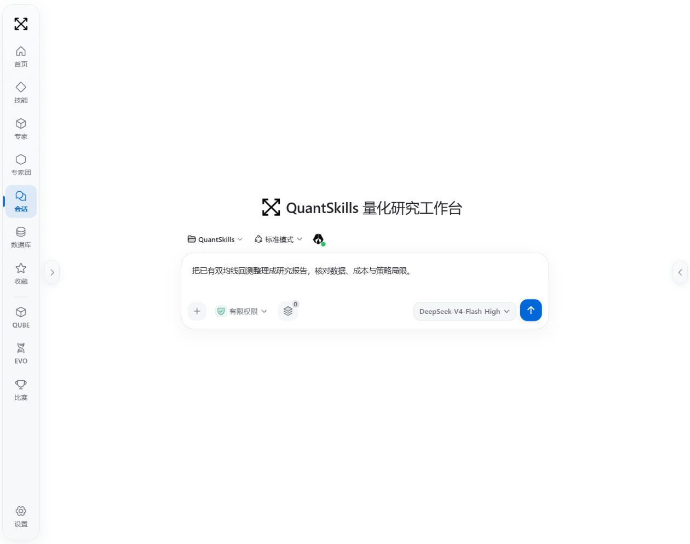
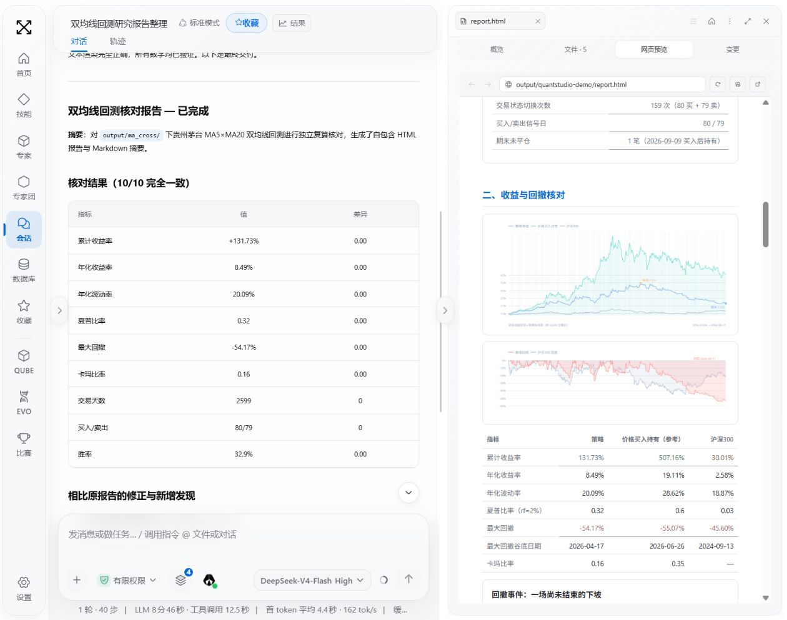
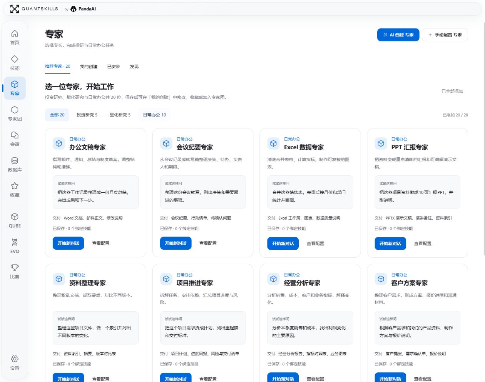

# QuantStudio

[English](README.en.md)

QuantStudio 是一个可本地运行的开源 AI 工作台，用于量化研究、数据分析和日常办公。你可以检查策略回测、整理表格、生成研究报告，并在工作台查看和下载图表、代码及文件。

项目也提供期货模拟赛模块，通过比赛 CLI 连接模拟赛账户，支持行情跟踪、交易计划和成交回执查询。



## 开始使用

准备 **Git** 和 **Node.js 22.19 及以上的 22.x 版本，或 Node.js 24 及以上版本**。项目使用 pnpm 11.7.0。

安装 **v0.1.36** 稳定版。

```sh
git clone -c core.longpaths=true --branch v0.1.36 https://gitee.com/quantskills/QuantStudio.git
cd QuantStudio
corepack enable
corepack pnpm install --frozen-lockfile
corepack pnpm run web
```

也可从 GitHub 克隆，将仓库地址换成 `https://github.com/quantskills/QuantStudio.git`。Windows PowerShell 如果拦截脚本，可将 `corepack` 换成 `corepack.cmd`。

打开终端显示的地址，在「设置 → 模型服务」配置模型，然后新建会话。

<a id="agent-install"></a>

[用 Agent 安装](docs/installation.md#用-agent-安装) · [安装与故障排查](docs/installation.md)

工作台支持 Windows、macOS 和 Linux 本地运行，也可部署为团队共享工作区。各模块的运行环境要求见对应文档。

## QUANT：量化研究

从市场复盘、财报解读到因子研究、策略编写与回测审查，把问题交给对应的技能、专家或专家团。已有资料和数据可以直接放进工作区，研究过程保留在会话与执行轨迹中。

例如：**“把这份双均线回测整理成报告，检查交易成本、最大回撤和样本外表现。”** 一边对话核对结论，一边在右侧打开报告、表格和代码，继续追问时仍保留上下文。



**技能、专家、专家团各做什么？**

| 能力 | 用法 |
| --- | --- |
| **技能** | 保存一套方法和步骤，例如每日复盘、财务分析、因子检验。可以发现、安装，也可以把自己的流程创建为技能；普通工作区会话同样可以加载。 |
| **专家** | 把职责、技能和交付要求组合成角色，例如财报专家、回测审查师、PPT 汇报专家。 |
| **专家团** | 给复杂任务安排负责人、成员和任务依赖，例如分别研究行业、资金、基本面，再汇总报告。 |

**数据库**管理本地数据缓存，支持查询来源、日期范围和表格预览。**结果工作台**打开 HTML、Markdown、PDF 等报告与文件，便于核对与下载。在线能力目录与仓库附带的可迁移能力快照分别管理，见[快照与导入说明](docs/library-snapshot.md)。

## Work：日常工作

量化研究之外，QuantStudio 也处理日常办公任务：清洗表格、汇总销售数据、整理会议纪要、写文档、做演示文稿。选择一个专家，或让专家团分工处理同一批材料。

例如：**“合并这几份销售表，按月份和部门汇总，再做一份周会汇报。”** 交付的是可以打开检查的文件，具体格式取决于当前模型、技能与文档工具。



会话可以继续、归档、恢复或删除。「会话删除」保留生成文件；「完整删除」先展示可删除的文件清单，再次确认后处理。归档会话统一在设置中管理。[会话与文件管理说明](docs/session-lifecycle.md)

<a id="trade研究盯盘与交易"></a>

## 期货模拟赛

PandaAI 比赛 CLI 为 JEV 盯盘、AI 交易员和 Ai辅助连接同一个期货模拟赛账户。JEV 盯盘和 AI 交易员支持逐笔确认，也可在用户授权本轮运行后自动提交。Ai辅助生成的计划由用户确认。委托提交和实际成交分别记录。暂停会停止新委托，已提交委托和持仓仍需单独处理。

- [期货模拟赛与 JEV](docs/contest.md) · [JEV 多品种配置](docs/jev-multiple-contracts.md) · [AI 交易员配置与执行](docs/fly-integration.md)
- [因子比赛](docs/factor-contest.md)

## 更新与开发

应用支持 GitHub / Gitee 更新来源。正式版本在独立目录验证，正常重启后切换；更新保留自建能力、会话、模型配置、凭据、缓存和产物。仅同步 `main` 不会触发正式版本自动安装。[发布与镜像说明](docs/publishing.md)

`.DS_Store`、`Thumbs.db`、`desktop.ini` 等系统文件不会阻断托管安装与更新。真正的源码修改仍会保留，并使当前目录按开发模式运行；终端会显示实际运行目录。

```sh
corepack pnpm run check
corepack pnpm run test
corepack pnpm run test:update
corepack pnpm run ci:smoke
```

源码位于 `src/` 与 `packages/`，构建产物位于各包的 `lib/`，能力快照位于 `assets/library-v2/`。[贡献指南](CONTRIBUTING.md) · [运行时基线](SOURCE_BASELINE.md) · [版本记录](RELEASE_NOTES.md) · [宣传素材](docs/launch/README.md)

QuantStudio 采用 [GPL-3.0-or-later](LICENSE) / [PandaAI 商业授权](COMMERCIAL-LICENSE.md) 双授权。第三方组件遵循各自许可证，见[第三方声明](THIRD_PARTY_NOTICES.md)与 `LICENSES/`。
