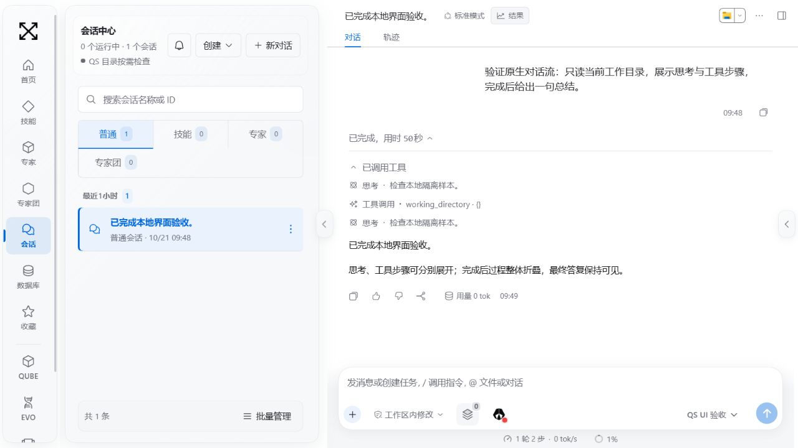
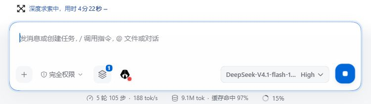
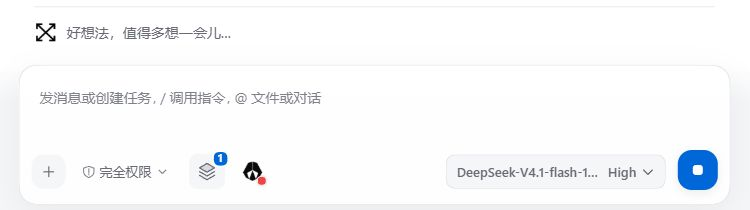

# Web 功能验收矩阵

2026-10-22 补充：PandaData 新授权与七合约分钟历史已只读验证，真实 Team 严格结果 4/6。最新提交、构建与外部条件见 [统一验收](unification-20261022.md)；下面历史状态不替代当前记录。

固定目标：DSH `0.2.1-rc.2`，上游源码 `687f282e8625c6b8d11ff58211a90524be2e4317`。逐包、逐行、预设及安装目标见 [生成清单](feature-inventory.json)；确切提交和平台结果见 [CI 证据](ci-validation.json)。

这里区分三种证据：实际构建在 Chromium/原生 Host 运行；安装包公开入口的隔离契约测试；固定上游源码的界面行为测试。服务加载成功只证明组合与依赖就绪，不代表外部账号、设备或每项功能实测成功。测试失败仍记录失败；未提供外部条件记录受阻。

## 模型与账号

| 入口与默认状态 | 验收 | 仍需的条件 |
| --- | --- | --- |
| QS 设置 → 模型服务；保留已有默认模型与路由 | Chromium 保存本机模型、发送流式消息、重载后继续使用；QS 模型/凭据测试覆盖脱敏与错误 | 外部推理服务需独立测试密钥；日常密钥不进入样本 |
| 完整工作台 → 模型选择/逐模型思考等级；随目标模型能力显示 | 固定上游模型设置与选择用例；实际浏览器选择本机模型 | 外部模型对每个等级的实际支持不能由本机固定文本证明 |
| 完整工作台 → 账号菜单；不自动登录 | 账号界面用例覆盖登录入口、取消/失败、退出后丢弃旧响应、重连、错误通知；页面真实可打开 | 真实登录、额度、问卷、充值等账号流程需测试账号；不在验收中支付 |

## 搜索与读取

入口为“设置 → 更多能力 → 完整工作台 → 插件 → 网页搜索”及对应工具；已有配置保留，密钥不预填。

- Chromium 已进入官方网页搜索配置页。
- 固定上游搜索设置测试覆盖配置、测试动作和错误呈现。
- `tests/upstream-runtime-contracts.spec.ts` 调用实际安装包：Search 返回结构化结果、503 反馈和取消；Fetch 本机页面读取、非文本拒绝、取消及默认私网保护。
- 实际外部搜索服务与公开网站读取尚需独立服务条件。本机传输替身只验证接口与失败处理，不冒充外网结果。

## 模式与创作

| 入口与默认状态 | 验收 |
| --- | --- |
| 会话模式选择：standard、cordis（创造）、minimal、ptc；保留原用户选择 | 四份官方预设由固定版本生成并带摘要；定制会话/输入及官方预设 UI 用例覆盖选择、表单、错误和状态 |
| PTC/持久代码执行；按选定模式提供 | 实际安装包验证同一 owner 保持变量、不同 owner 隔离、异常与释放；没有运行用户历史代码 |
| 创造模式中的插件创建；不自动执行生成插件 | 使用官方插件与代码工具，插件安装/停用/卸载只经官方管理器；源码 UI 验证预览、确认和失败。外部模型自主生成一个实际可用插件仍需独立模型验收 |

## 会话与协作

会话、附件、审批、专家团及子任务入口保留。114 个定制 UI 用例文件验证 QS 合并后的源码，浏览器另验证实际构建的发送、流式回复、附件、草稿重载和缩窄后续聊。

官方 Agent Team 是唯一运行时。QS 适配层的迁移与恢复测试覆盖已投递、确定未投递、历史不确定、接收成功但未写回执、重复恢复、父子关系和原 ID。未知事件原文保留；不确定消息不自动补发。真实备份只做离线迁移，未投递任何消息。

两项按需子智能体（Claude Code、Codex）默认不安装。官方管理器返回的安装目标必须精确为 `@0.2.1-rc.2`，该断言进入 `ci-optional-bundles.mjs`；实际第三方 CLI 登录和委派需独立测试环境，当前受阻。

## 工作环境

| 入口与默认状态 | 验收 | 条件 |
| --- | --- | --- |
| 工作目录选择、目录工具和共享指令；保留原路径配置 | 工作区/路径/生命周期回归；构造样本的全部可执行路径只能指向临时目录 | 原工作区不会被测试打开或修改 |
| 官方插件 → Worktree；默认关闭 | 配置启停、重启保存；安装包真实创建 Git worktree、无调用者时拒绝、服务释放后注销工具 | 只操作新建 Git fixture |
| Web 支持的 SSH 入口；不自动连接 | 目标组合及配置入口保留，现有路径与隔离回归 | 真实远端登录、命令、断线恢复需专用 SSH 测试机，受阻 |

## 自动化

QS 设置 → 更多能力 → 管理自动化任务，进入官方任务管理页。Chromium 验证该入口；官方 UI 用例覆盖创建、详情、启停、关联会话、删除及失败状态；实际安装包验证任务存储创建、停用、服务重建后读取、启用、删除和无效周期拒绝。

迁移不补跑历史任务，隔离样本没有历史自动执行。测试中没有启动真实周期任务去调用外部模型；端到端定时模型执行需独立模型条件。

## 调试与辅助

完整工作台提供官方设置和开发者入口；QS 日常页面保留自身布局。

| 可选 bundle（均默认关闭） | 已验证 | 尚未完成的外部验收 |
| --- | --- | --- |
| session-search | 官方管理器启停、重复操作、重启持久化、完整组合激活 | 无外部条件；检索交互见会话回归范围 |
| ralph | 同上；目标模式与会话 UI | 外部模型的持续任务执行 |
| terminal | 同上；原生子进程隔离与回收、定制布局 | 人工交互终端体验不以 jsdom 证明 |
| badge-skill | 同上；技能/输入 UI | 无外部账号调用 |
| session-titles | 同上；Chromium 本机模型实际自动标题 | 外部标题模型质量 |
| agent-team-profile | 同上；官方 Team 运行时和迁移/恢复 | 外部模型多人协作的质量 |
| voice-input | 同上；设备/配置界面由官方包提供 | 真实麦克风、浏览器权限、语音服务 |
| cot-translation | 同上；设置保留 | 真实翻译服务与流式翻译 |
| auto-review | 同上；审批 UI/授权边界回归 | 独立外部审核模型 |
| inspector-profile | 同上；完整设置与开发者入口 | 无需生产凭据 |
| plugin-market-bundle | 同上；固定目录、官方 Discover 入口、来源迁移和实际安装矩阵 | 第三方目录中每个插件的功能不属于本 PR |
| tool-worktree | 同上；实际安装包创建与注销测试 | 无外部账号条件 |

## 通用交互与 QS

草稿、引用、字体、步骤折叠、模型目录、消息与状态通知由目标上游能力和四包合并保留。真实 Chromium 处理实际加载的 QS 构建，不能用源码测试替代；字体 CSS 用例统一 CRLF/LF 后继续验证原选择器。

Trade 的 JEV、多合约、小果配置、模拟回执、手续费/净盈亏、图表、分页与记录删除在 QS 全量回归中验证，未连接比赛账户、启动交易员或发送测试单。真实比赛服务验收需另有可用的仿真服务和明确测试窗口；不将原数据副本直接启动来凑证据。

## 合并门槛

安装、启动器、数据、Team、来源迁移、定制 UI、构建、原生恢复或三平台当前提交 CI 有失败时，禁止标记可合并。范围内关键外部流程受阻时同样保留 Draft。原生桌面安装器、移动端及独立 SDK 产品不适用。

验收报告应填写具体账号类型（不含凭据）、服务/设备条件、提交、实际制品、操作和结果。当前没有这些条件的项目保持受阻，不猜测通过，也不导入日常配置绕过隔离。

## 2026-10-21：原生对话交互复核

按用户要求，对话区采用固定目标 DSH 的交互和折叠方式，保留 QS 品牌与业务扩展。基于 `b6e917fd616f209d3cb9be0cc82c9c88cacbc641` 的本地工作树，未合并主线；本次最终构建摘要为 `269a12e4c1f35e623b92293024f47ce499440f942530a9733c3dc6091a78212a`。该摘要由 `candidateArtifact()` 对实际程序、配置及构建文件计算，不能将基线提交当作本次未提交修改的测试证据。

**原因与处理：** 旧 QS 全局样式给原生 24px 思考摘要加上卡片留白，造成文字裁切；额外的高度限制、会话页头隐藏和输入区子智能体传送挂载，也与新版交互不一致。恢复目标上游的思考、执行过程、会话页头及输入区布局，移除旧几何样式覆盖。默认采用桌面端的 standard 步骤分组，已保存的显示偏好仍优先。运行状态显示实际耗时，QS 图标通过扩展槽替换；完整工作台保留原生状态回退。

QS 的导航、主题、附件、模型选择、PandaData、创作确认、成果入口和专家团扩展保留。未更改模型协议、交易执行、迁移逻辑、原会话文件或日常实例配置；用户进行中的任务没有被停止。

| 检查 | 结果与边界 |
| --- | --- |
| 上游源码对照 | 5 个恢复文件与固定上游一致（忽略 CRLF/LF）；三方记录及变更测试的摘要已更新 |
| 114 个上游 UI 测试文件 | 首轮 1905 通过、4 失败；失败均为旧默认模式或隐藏页头预期。按新要求调整后，相关 3 文件 34/34 通过；未跳过用例。此结果来自全量首轮与定向复测，非一次全绿运行 |
| 最终状态组件 | 3/3 通过，核验耗时更新、持续运行和计时器释放 |
| QS 组件回归 | 最终 5 文件 39/39 通过，覆盖原生页头上的业务入口、创作确认、附件、品牌与主题。依赖包缺少 sourcemap 的警告不影响断言，但仍保留在本机日志中 |
| 最终前端构建 | `pnpm run build:client` 通过，包含各包 TypeScript 编译；源目录检查通过 |
| Windows 实际浏览器 | 独立空数据目录、端口 3398、纯本地 SSE 模型（3399），只调用只读工作目录工具。运行时步骤分组收起，完成后整轮过程收起且答复保留；手动展开步骤、工具结果及思考均正常 |
| 长思考与重载 | 18 段构造思考可展开，正文实测 484px、`max-height: none`；摘要保持 24px 且无额外 padding。重载最终构建后原测试会话保留，折叠交互正常；浅色/深色均检查 |
| 测试隔离 | 浏览器测试不携带日常凭据、不调用 PandaAI 额度、不访问原工作区；只使用临时样本。测试服务结束后回收 |
| 本轮未重测 | macOS/Linux 浏览器、真实外部模型能力、真实审批与专家团协作全链路；既有升级门槛不因本轮界面验收而自动解除 |

实际浏览器截图（隔离样本，非用户会话）：

### 同日补充：输入框沿用 QS

用户明确要求输入框保留 QS 外观。恢复 QS 卡片、聚焦描边、模型胶囊、工具栏间距及发送/停止按钮；新版 DSH 的对话分组、思考展开和整轮折叠保留。输入编辑、草稿、附件、模型选择和发送状态仍由新版编辑器负责，未恢复旧版固定占用 430px 的空输入框定位。

输入框与输入场景测试 139/139，QS 附件及主题测试 26/26，完整前端构建通过。未增加模型请求、未停止正在执行的用户任务、未修改原数据及配置。此次构建摘要：`d465e95ee11a79c68a287511bfa193ed274908a880583803cbbfd1709320e806`。上方截图与摘要对应上一轮原生输入框检查；本次输入框外观以此补充记录为准。

Windows 浏览器实测：宽列卡片 712px、圆角 24px，发送/停止按钮圆角 14px，聚焦描边正常；窄列 361px 时工具栏换行，按钮仍在卡片边界内，草稿区域使用完整宽度。仅收起两侧面板以展示输入框，没有发送消息或停止任务。

### 同日补充：品牌提示与正文沿用 QS

按用户最新要求，恢复原版 QS 动态品牌标识、浅深色动画、减少动态效果时的静态标识，以及每 5 秒轮换的研究提示语。QS 会话不再显示原生蓝色“深度求索中，用时…”；完整工作台仍有原生状态回退。正文的段落、标题、列表、引用和表格恢复 QS 排版，选择器排除思考区域，避免影响新版折叠与展开。输入框保持上一次确认的 QS 外观。

品牌与主题 24 项回归通过，QS 包 TypeScript 编译和客户端构建通过。Windows 实际页面确认动画资源成功加载、提示语轮换、灰色文案及 QS 表格样式；没有发起额外模型调用或中断现有任务。此轮实际构建摘要：`2c8feaae164d0dc1db96fbf1fc778333439dacf2f393773605b8d06b0947808c`。此前关于 QS 保留原生运行文案的记录由本段修订，时间计算与运行时未改变。

### 同日补充：单行标题栏与官方右侧栏

采用目标 DSH 的右侧标签栏、文件导航、代码/图片预览和收起机制；QS 的结果汇总作为一个标签接入。报告、音视频沿用 QS 预览组件，HTML 保留原有双层隔离与外网限制，视频不自动播放。QS 文件入口、交付卡片及行内文件链接统一进入该侧栏，旧结果抽屉仅作为非原生模式或缺少官方服务时的回退。保留 QS 品牌、输入框和业务入口。

“对话 / 轨迹”移入标题与操作按钮所在行，保留原生标签语义、状态和回调。结果列表合并已保存文件与助手交付声明，经 Host 校验后按规范路径去重；不再把普通变量或工具名称识别为文件。交付声明复用聊天包的纯解析入口，没有复制解析规则。

实测发现旧文件流路由遗漏 rc.2 要求的 requestBody 声明，GET/HEAD 被错误按流式请求体处理并返回 HTTP 400。改用官方 Connection 接口类型并声明 buffered；补充真实 HTTP 桥接的 Range/HEAD 回归。官方 HTML Blob 预览在当前内嵌浏览器中出现空白，因此 QS HTML 报告使用原有隔离预览器接入官方标签栏；未降低浏览器或文档安全设置，未宣称修复上游 Blob 预览器本身。

| 检查 | 本轮结果 |
| --- | --- |
| QS 与侧栏组件 | 5 文件 46/46，通过会话归属、失效请求取消、交付文件归集、下载/续聊接口、错误反馈和 HTML 隔离断言 |
| Host 会话与文件服务 | 49/49，含实际 rc.2 HTTP 桥接 GET Range、HEAD、路径越界与无效 Range |
| 上游会话组装 | 5/5；合计本轮相关测试 100/100 |
| 编译与构建 | 变更包 TypeScript 通过；聊天、会话、QS 客户端及根 Host 构建通过；源目录与 diff 空白检查通过 |
| Windows 浏览器 | 3298 实际页面：20 个去重结果，报告/代码/图片/工作区导航正常，视频 metadata 8 秒、1920×1080，未自动播放；轨迹切换、收起和恢复正常，仅一套右栏 |
| 窄列标题栏 | 400px 与 584px 的标题栏 scrollWidth 均等于 clientWidth，标签保持同一行 |
| 数据与配置 | 任务完成后备份并重启同一预览实例。5 个原会话日志的已有字节完整保留；仅当前会话追加 session/end-seed，派生缓存随之更新。凭据、用户配置及 web Profile 用户覆盖层校验未变化 |
| 验收边界 | 本轮未重新执行 macOS/Linux 浏览器、真实交易或外部模型验收；整体升级仍按既有门槛判定。本轮没有合并或同步主线 |

最终实际构建摘要：`765c0758afea76410bbcff9f64c5d4e3159a6fd13973f7517a3722c35e511eed`。截图保存在本机 runtime-logs/qs-native-sidebar-20261021.png；其中含用户的实际会话，仅作本地展示，不加入仓库截图。

### 同日补充：保留左右边缘箭头

按用户要求保留 QS 两侧中部的展开/收起箭头。右侧箭头调用官方 sidebarRight.toggleExpanded，不新建标签或切回结果汇总；收起后在窗口右边缘，展开后在面板左边缘。通过 shell.overlay 的可选几何信息随面板宽度定位，全屏和移动端继续使用官方控制，旧结果抽屉入口保持回退。

布局与 QS 包编译、构建通过；现有布局 45 项、原生组合与结果 13 项测试通过（共 58 项）。Windows 3298 实际点按确认收起、展开和 delivery.html 标签保留，左侧会话箭头同时存在。仅重载前端，用户正在运行的任务持续运行，未重启 Host 或修改数据、模型及配置。效果截图仅保存在本机 runtime-logs/qs-right-sidebar-arrow-20261021.png。

### 同日补充：添加菜单使用实色背景

输入框“＋”菜单透出正文，是 rc.2 MenuSurface 改用 `--dsw-menu-surface-fill` 与 `--dsw-menu-backdrop-filter`，而 QS 仅覆盖旧 `--dsw-specific-menu` 所致。浏览器确认原材质为 `rgba(248, 249, 250, 0.58)`，与 QS 输入框的玻璃背景叠加。补齐 QS 菜单主题变量，使用当前主题的实色 surface 并关闭菜单背景模糊，保留输入框自身样式。

实际 Windows 3298 菜单材质已为 `rgb(255, 255, 255)`、opacity 1、backdrop-filter none，正文不再穿透。客户端构建通过，现有菜单 25 项与主题 18 项测试通过（共 43 项）。样式热更新生效，未重启 Host 或中断用户任务。截图仅保存在本机 runtime-logs/qs-opaque-add-menu-20261021.png。

### 同日补充：移除遗留子智能体弹窗

旧 QS 子智能体适配层仍拦截 uiWorkspace.openSession，并插入独立遮罩和标题条；其依赖的旧会话根节点已不匹配新版布局，导致灰色遮罩覆盖正文。删除该拦截模块、注册和对应样式，由官方子智能体目录及会话导航接管打开与返回。保留 QS 品牌、输入框、左右边缘箭头和业务扩展。

QS 包 TypeScript 与客户端构建通过，旧模块及遮罩标识不再存在于实际客户端产物。现有上游会话骨架 27 项、QS 原生组合与页头 13 项测试通过（共 40 项）。Windows 3298 浏览器刷新前端后，实测主会话打开子智能体、点击顶部主会话名称返回；两个视图的遗留遮罩、标题条及 body 标识数量均为 0。4 个已有子智能体仍显示运行中，没有重启 Host、发送消息或修改数据与配置。其他已加载旧前端的标签需刷新以释放内存中的旧导航包装。

截图仅保存在本机 runtime-logs/qs-native-subagent-view-20261021.png，含实际用户会话，不加入仓库。本轮仅验证上述交互，不替代升级计划中的其他验收；未提交、推送或合并。

### 同日补充：修复专家会话一直“正在准备”

新版 DSH 的会话目录成员不再自动拥有客户端 binding，必须显式 retain 并等待 reference.ready。QS 旧 adoptSession 仅订阅目录、等待 binding 自行出现，却在等待完成后才打开视图，导致首次创建专家会话可能无限等待。改为使用官方 retain 接口，刷新必要的目录及投影，仍按原规则核验精确专家/团队/技能配置；引用由调用范围持有并在成功交接或失败时释放。接入等待上限 30 秒，错误提示明确已创建的会话无需重复创建。

同时将专家和专家团创建后的历史全量刷新转为后台执行。原路径在新会话已经创建后，仍等待定义、团队与历史等五项读取完成，额外阻塞接入；后台刷新保留原错误反馈与权威数据来源。

QS TypeScript 编译和客户端构建通过，接入、控制器、原生组合、能力选择器及页头共 29 项测试通过。新增用例覆盖未选中会话必须主动 retain、精确配置不符、打开失败、取消、目录挂起超时及历史读取未完成时仍可接入。Windows 3298 通过实际“＋ → QuantSkills → 个股研究专家 → 开始对话”创建一个空白会话，从点击到选择器关闭约 484ms（单次实测，非性能保证）；已显示原模型、专家能力和保存的权限，无模型消息发送。随后返回原会话，4 个子智能体仍显示运行中。

本轮只刷新前端，未重启 Host、改动原配置或删除历史。验证产生一个空白专家会话并保留；截图保存在本机 runtime-logs/qs-agent-start-fixed-20261021.png，不加入仓库。未提交、推送或合并主线。

### 同日补充：取消携带产物到新会话

按用户确认取消这项功能。从官方侧栏的 QS 结果汇总及兼容结果面板同时移除“携带文件/产物到新会话”入口、状态和创建后续会话的回调，不再将普通会话缺少该分支列为待修复功能。保留文件预览、下载和工作区浏览；普通新建会话及官方对话分支不属于本次移除范围。

QS TypeScript 编译、客户端构建及 37 项现有结果/原生组合回归通过。独立 Windows 3298 标签验证已有文件会话：结果区显示 18 个可用文件，下载及浏览工作区入口存在，携带文件到新会话按钮数量为 0。截图仅保存在本机 runtime-logs/qs-result-continuation-removed-20261021.png。未重启 Host、发送消息、删除文件或修改用户配置；原标签中的专家团确认窗口保持不动。本项调整不代表其余升级验收和打包缺口已完成，未提交、推送或合并。

### 同日补充：安装包导出修复及 PR 同步

公开 deliverables 导出缺失的 JS 文件已纳入精确发布清单。真实插件归档和 QS 整包分别在仓库外解包，并通过公开包名加载、解析有效报告及拒绝越界路径；四组 CI 增加同一验证步骤。今天的界面、侧栏、菜单、子智能体及会话接入修复和取消产物续聊一起记录在代码提交 `41bab60797195e7f41eafe7630908591375cd475`。完整构建与 1,455 + 1,909 + 2,830 项回归通过，1 项平台专项跳过。确切制品和归档摘要见 [本次验证](followup-validation-20261021.json)，最新跨平台结果以 PR 当前提交的 Checks 为准。此前各节的“未提交”是当时状态；不代表这些修复仍未纳入分支。PR 保持 Draft，外部验收缺口仍按原门槛处理，不合并或修改日常实例。
