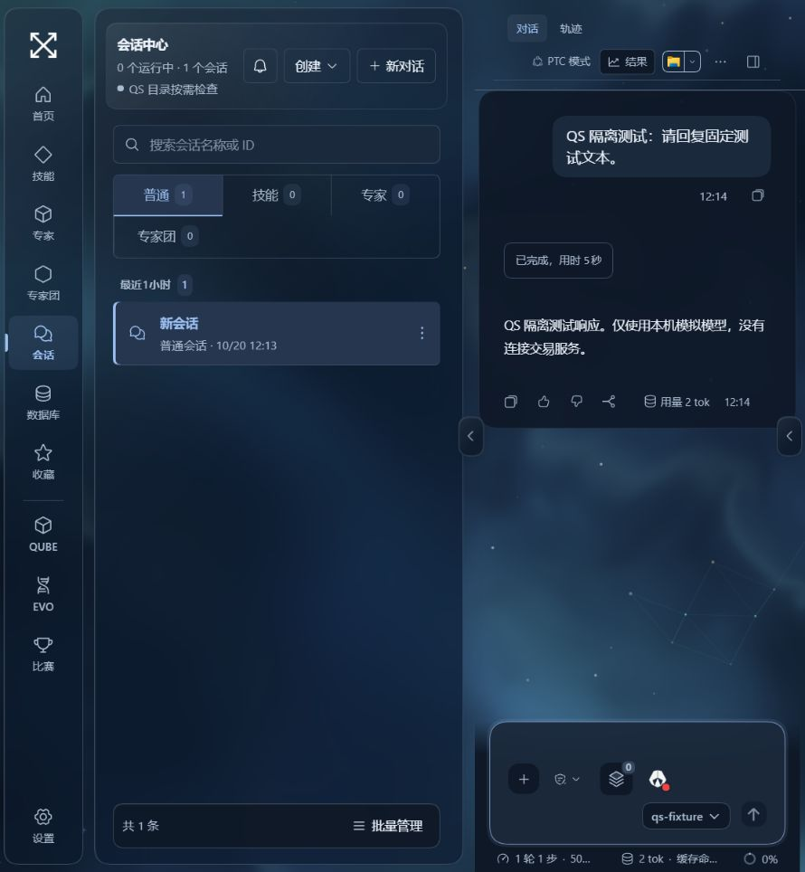

# DSH 0.2.1-rc.2 候选测试报告

日期：2026-10-20。状态：**Draft / 尚未满足全部合并条件**。

## 验收对象与环境

- 本地全量与新核心启动验收：`aa375e4f9936f016b8465bc130b91fab47436eb1`。浏览器交互验收：`2615d37d20f32e2c51c7f2879c6ebfcf87e1ff7b`。各证据分别绑定实际提交，后续文档提交不替代这些验收对象。
- 原生启动报告的 DSH：`0.2.1-rc.2`。
- 原生启动制品摘要：`72b4656ba4ed4b085e6627486246550cb0b62c595a00f567c451a785dd7fa4c6`。
- Windows x64，Node `22.23.2`，pnpm `11.7.0`。其他 Node 版本的 engines 声明不算实测。
- 旧主线基线：`8312624953d62a9aec5cde2c0c2f1175342482fe`，旧版代表性检查为 6 个文件、134 项通过；不是全量旧版验收。
- 所有运行测试使用构造数据。历史兼容副本仅离线转换，不启动 Host。

## 已通过

| 项目 | 结果及证据边界 |
| --- | --- |
| 固定安装 | `pnpm install --frozen-lockfile` 通过；DSH 固定版本、补丁摘要和上游完整性进入锁文件 |
| 类型及源码检查 | `pnpm run check` 通过；根项目及 12 个内部包 |
| 完整构建 | `pnpm run build` 通过；后端、生成接口、四个定制前端包及 QS 客户端 |
| 全量测试 | 134 个测试文件，**1,412 项通过、0 失败、1 项 POSIX 专项跳过**；`aa375e4-tests.json`，95.15 秒；Windows 不执行 POSIX 进程组测试 |
| 启动身份 | 真正的父子进程 IPC 握手核对提交、核心、代际、制品摘要及服务；随后独立检查 HTTP 模块入口 |
| 协议与失败保护 | 未知状态、未完成迁移、错误身份、旧实例占端口、Profile 事务恢复和不安全回退拒绝等构造测试 |
| 离线报告隔离 | 即使把离线转换报告复制到启动器读取的位置，也不能授权完整数据目录启动或回退；`runnable:false` 和离线种类均在运行时拒绝 |
| 运行样本检查 | 检查序列化工具参数中的路径与命令，拒绝无法解析的参数、待执行脚本和包生命周期脚本；浏览器测试密钥须为本次生成并核对摘要 |
| 启动器先行升级 | 协议 2 启动器成功运行固定旧 QS 基线及 `0.1.2-alpha.2` 核心；全新临时 Profile、进程存活、页面及隔离检查通过，随后清理；`pnpm run ci:legacy -- /independent/baseline` 可复现 |
| 用户插件选择 | 已安装但停用的插件保持停用；来源不明的已选 bundle 保留；显式卸载与新装默认组合分别验证 |
| 路径别名 | Windows junction / macOS 祖先别名可用，工作区内部逃逸链接仍拒绝；真实存储后端删除及文件保留回归通过 |
| Windows 原生进程 | 官方新版 subprocess 的 Windows JobObject / 子孙进程回收；不再保留旧 Windows 补丁 |
| 存储生命周期 | 删除、恢复、并发写入、错误物理头部、缓存不回生、共享文件保护专项测试 |
| Team | 官方单一运行时，稳定 ID、已接收未写回执、重复继续、历史不确定不补发等单元及原生持久化集成测试 |
| 插件来源 | npm/Git/子目录/压缩包/本地链接/未知来源分类和保留约束测试；**不代表真实安装更新矩阵通过** |
| Trade 回归 | 全量套件包含 JEV、多合约、自动交易约束、回执、费用/净盈亏、图表和记录管理的构造测试；未连接交易账户 |

全量测试中的 jsdom 图表尺寸警告和 PDF `DOMMatrix` 限制不作为真实浏览器渲染证据。源码中的旧 `dsh-invariants` 已移除，必要行为由专项测试覆盖。

## 真实历史副本（离线）

使用 2026-10-18 已有一致性备份；不是在本次运行中取得的当前数据快照。

- 84 个压缩会话完整解码，包含所有连续 Zstd 帧。
- 转换后 11,491 条目标事件；旧格式打包块经官方转换链展开/收敛，物理行数不用于判定完整性。
- 106 条 Team 事件映射、106 条 QS 元数据映射；此样本未知事件 0。
- 原文件与校验保留，目标格式重新读取及重复执行核对通过。
- 代际：`916f707cf661ba122085e075f1f7c65c2ca2fe666595cf2a11d59219962bc16f`。
- `runnable: false`。这不是整个数据目录的激活证书，不能据此修改真实目录迁移日志为 validated。

本地构造样本验收另见 [脱敏验收摘要](local-validation.json)。真实历史公开证据为 [脱敏数量和摘要](offline-data-proof.json)。原始备份、私有会话及详细错误不进入 PR。

## Windows 浏览器实测

在临时 DSH_HOME、临时 Documents、临时用户级缓存和无生产凭据环境中：

- 工作台、目录、设置和模型配置入口正常加载。
- 创建普通会话；标准、PTC、极简、创造四个预设入口可见。
- 选择 PTC、输入草稿，页面重载后重新打开会话，模式与草稿保留。
- 配置本机无鉴权 OpenAI 兼容模拟服务，发现模型、验证保存、在模型选择器选用该路由。
- 实际发送构造消息，Host 调用本机模拟模型并在聊天界面显示流式回复、完成状态和用量。
- 运行轨迹入口能显示目标格式事件。
- 上传构造的 `attachment.txt`，可见文件名、持久引用及移除入口；发送引用后得到本机模拟模型回复。
- 将含三轮对话和附件引用的会话归档，再从设置恢复；历史内容、PTC 模式和模型选择仍保留。
- 比赛页显示“开启比赛模式”的未连接空状态；没有连接账户或启动交易。

模拟模型只返回固定文本，不证明真实外部模型质量、工具调用、SSH、账号授权或交易服务恢复。

本轮浏览器交互结束时，隔离器将新版自动生成的浏览器认证记录误判为导入凭据，最终检查失败，临时数据因此保留而未清理。后续修复改为：测试启动前自行生成一次性浏览器密钥，在父进程保留摘要并逐次核对；只允许构造样本的本机无鉴权模型占位值，其他记录和凭据一律拒绝。新增测试覆盖未知凭据、摘要变化及额外记录的拒绝。另修复发送或移除附件后残留“已附加”状态提示。修复后的 `aa375e4` 已完成新的实际启动、握手、隔离复查及清理，见 `aa375e4-smoke.log`；早期失败记录仍不计为通过。

## CI 发现及修复记录

第一次候选 CI（[运行 39369180169](https://github.com/quantskills/QuantStudio/actions/runs/39369180169)）三平台均通过安装、源码检查和构建，但测试失败。定位并修复了路径祖先别名误拒绝、非 Windows 平台错误断言 windowsHide、快照内嵌 .gitattributes 覆盖换行规则，以及文档解析冷启动测试时限。失败证据保留，不计通过。

第二次 CI 的 Linux 集成测试出现一次 5 秒超时，后续未改动该用例的运行通过；被后续提交取消的平台不计通过。第三次运行的 Windows 完整任务通过，macOS/Linux 在全部测试通过后暴露启动烟测未退出的问题：只结束父启动器时，Host 孙进程仍占用输出管道。现已将测试启动器放在独立 POSIX 进程组中，结束时回收整组，并增加忽略 TERM 的孙进程回归测试。

`aa375e4` 对应的 [CI 39371567837](https://github.com/quantskills/QuantStudio/actions/runs/39371567837) 在 Windows、macOS、Linux / Node 22.19.0 上完整通过：Windows 1,412 项通过、1 项 POSIX 专项跳过；macOS/Linux 各 1,409 项通过、4 项 Windows 专项跳过。三平台的新核心和真实旧核心原生启动均通过。GitHub 实际检出的临时合并提交是 `2ce9ad348157be2b4df83625693b29887275a730`。同次 Node 24.0.0 的原生进程测试因默认 1 秒等待窗口未等到完整 stdout 而失败；已改为等待完整换行帧，启动等待 5 秒、测试总时限 20 秒，不跳过断言。后续运行结果单独记录，不把失败计为通过。

实施前备份的 48 个原工作区修改文件再次逐一核对 SHA-256，均未变化。

## 未完成 / 受阻 / 不适用

| 状态 | 范围 | 合并要求 |
| --- | --- | --- |
| 未完成 | 官方插件管理器成为唯一修改入口；QS 核心保护；五类来源真实安装/更新/失败/并发 | 完成实现与来源迁移验收前保留旧市场，不能标记可合并 |
| 未完成 | 整目录迁移和激活：Profile、缓存、附件、自动任务、交易数据、删除恢复日志的统一对账 | 当前一致性快照、语义核对、备份与代际证书齐全 |
| 未完成 | 迁移后新增数据保全和整目录回退；新启动器运行真实旧核心已在 Windows 通过 | 在独立样本上完成完整恢复演练 |
| 未完成 | 27 个定制 UI 冲突文件的全部视觉复核、全部功能成功/失败/持久化 | 按功能清单补齐证据，不能仅看依赖版本 |
| 待复验 | Node 24 原生进程测试等待修正后的 CI | Node 22.19.0 三平台已通过；Node 24 失败不计通过 |
| 受阻 | macOS 浏览器、语音设备、SSH、真实账号和外部服务 | 需要对应平台/硬件/授权测试条件；受阻不计通过 |
| 不适用 | 原生桌面安装器、移动端、独立 SDK 产品 | 本次范围外 |

合并阻塞项见 [升级状态](README.md)。正式发行版本号保持不变，未创建发布标签、未切换日常实例、未更新 Gitee 主线。
